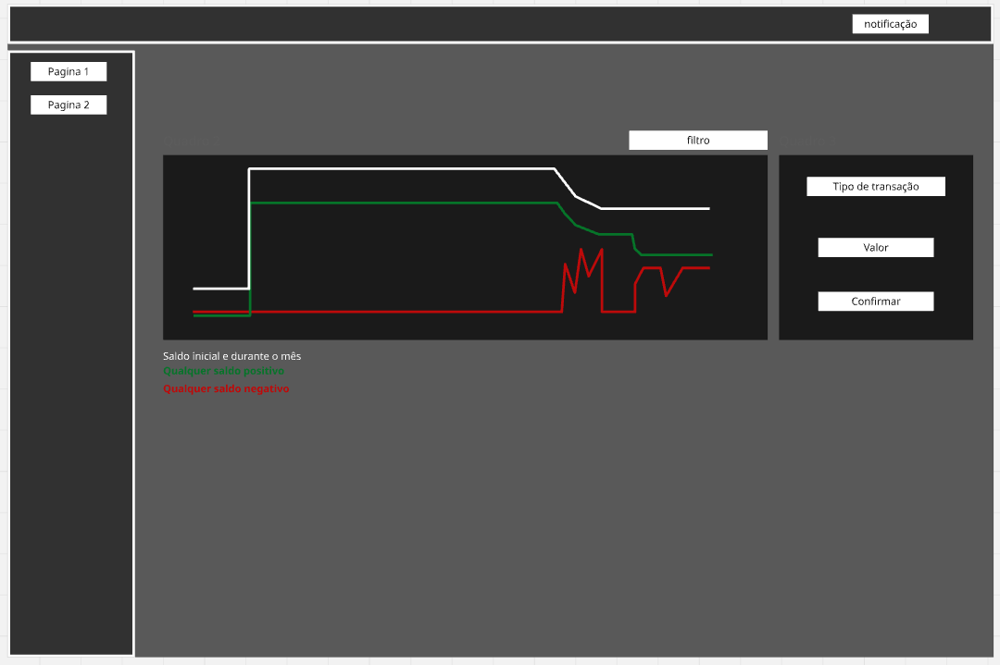

# Gestao-de-Financas-com-Dashboard

Sistema de gestão e rastreamento de financas interativo, com dashboard, histórico de transação.
Intuito principal é desse projeto ser desenvolvido sem ajuda de IA.

Ferramentas utilizadas: Java, Springboot, Docker, PostgreSQL, React.

MVP(Produto Mínimo Viável)
    - Sistema deve conter duas páginas principais.
        
    #PÁGINA PRINCIPAL (DASHBOARD E INSERÇÃO DE TRANSAÇÕES)
        - Dashboard:Contem gráfico interativo do sistema, mostrando horario,data e valor das 
                    transações no estilo Banco de ações. Interativo, possuindo filtro entre dia, semana e ano. Possui 3 linhas principais(gasto diario, valor na conta, gasto mensal).

                    
        
    #PÁGINA SEGUNDARIA (HISTORICO E PESQUISAS)
        - Histórico: Mostra todas as transações feita pelo usuário. Possuindo um filtro que 
                    permite mostrar apenas categorias unicas, mostrar todas as categorias, filtrar por data.